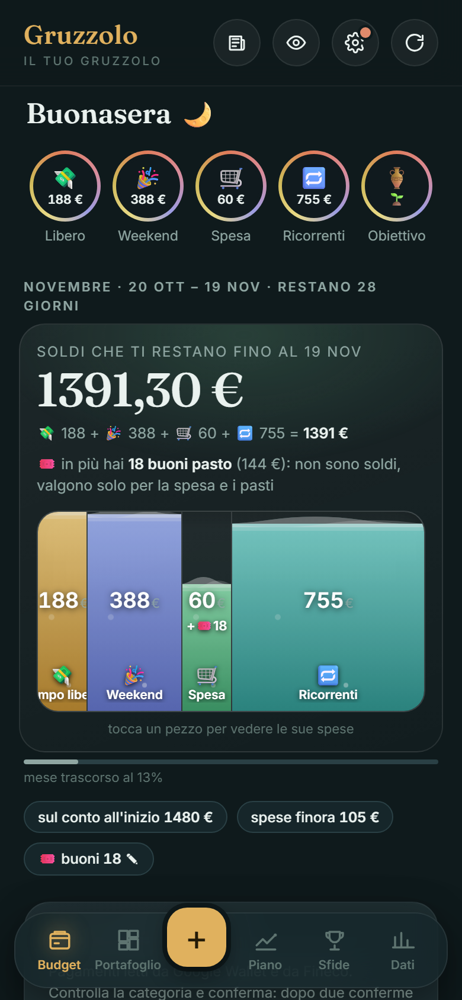
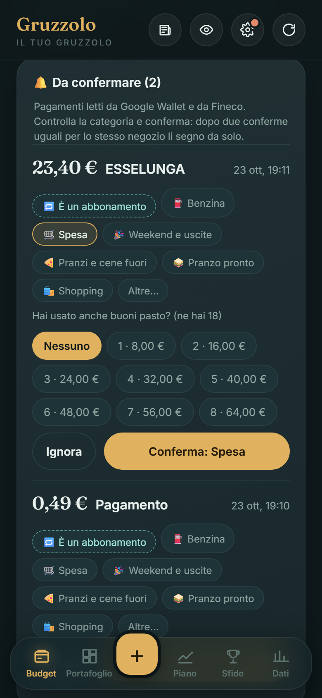
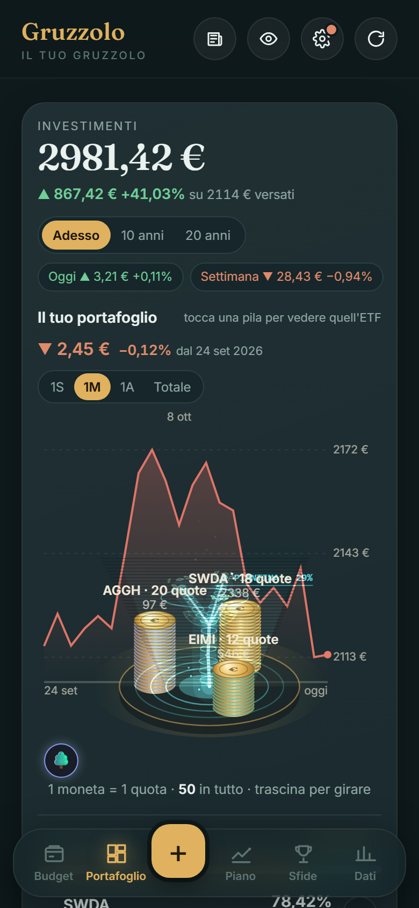
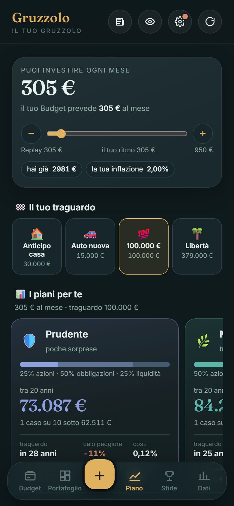

# Gruzzolo

**Il budget che si fa da solo, e il risparmio che diventa investimento.**

Gruzzolo è un'app Android in italiano per chi prende uno stipendio e vuole sapere, ogni giorno, quanto può ancora spendere fino al prossimo, senza fogli di calcolo e senza segnare tutto a mano. Le spese arrivano dalle notifiche dei pagamenti (Google Wallet e la banca), i buoni pasto si contano a parte e quello che avanza diventa un piano di investimento con ETF.

### ▶️ [Provala nel browser](https://charles1812.github.io/gruzzolo/)

Non serve installare né scaricare niente: è la stessa app che gira sul telefono, aperta in una pagina web. Tocca **🧪 Demo → ✨ Prova con un esempio** per vederla subito piena di dati, oppure **Parti da zero** e rispondi tu alle domande. I dati restano solo nel tuo browser. Le notifiche dei pagamenti, che sul telefono arrivano da sole, qui si simulano con **📲 Simula un pagamento**.

<p>




</p>

---

## Cosa fa

### 💸 Budget: quanto ti resta, davvero
Il numero grande in alto è **quanto ti resta sul conto fino al prossimo stipendio**: soldi veri, già tolti l'affitto, le bollette e gli abbonamenti che devono ancora arrivare. Il serbatoio sotto lo divide in quattro budget, e la somma dei pezzi fa sempre esattamente quel numero:

| | Budget | Cosa ci finisce |
|---|---|---|
| 💸 | **Tempo libero** | Un salvadanaio unico: lo spendi come vuoi (shopping, regali, cene…). Le categorie sono solo etichette. |
| 🎉 | **Weekend** | Da venerdì alle 18 a domenica alle 5. Quello che non spendi in un weekend passa al Tempo libero. |
| 🛒 | **Spesa** | Supermercato e pranzi, con i **buoni pasto** a parte: non sono soldi, valgono solo qui. |
| 🔁 | **Ricorrenti** | Affitto, bollette, telefono, abbonamenti, benzina, e gli accantonamenti per le spese annuali (assicurazione, bollo). |

Toccando un pezzo si apre la sua finestra: le spese che lo compongono, giorno per giorno, il calendario degli addebiti.

### 📲 Le spese si segnano da sole
Quando paghi con il telefono o arriva la notifica della banca, Gruzzolo legge **solo quel pagamento** e ti propone la spesa già compilata: importo, negozio e categoria. Tu la confermi con un tocco, anche direttamente dalla notifica. Dopo due conferme uguali per lo stesso negozio, la segna da solo.
- Se hai pagato in parte con i buoni pasto, te lo chiede.
- Se l'avevi già scritta a mano, non la conta due volte.
- Se è un abbonamento, con **🔁 È un abbonamento** diventa una spesa ricorrente con la data del prelievo. Il mese dopo la riconosce («Sembra Netflix»).

### 🔁 Abbonamenti e spese ricorrenti
Per ogni abbonamento metti nome, importo, ogni mese o ogni anno e la data del prelievo. Gruzzolo li tiene nel budget del mese, li mostra in un calendario e, se il pagamento non arriva, ti chiede se è stato pagato. Quelli annuali vengono accantonati un pezzo al mese.

### 🌱 Il primo mese
Fino al primo stipendio preso con l'app non ti chiede di mettere da parte niente: ti aiuta solo a gestire quello che c'è. Dal mese dopo arriva l'obiettivo di risparmio, calcolato sulle tue spese reali.

### 📈 Portafoglio e Piano
- **Portafoglio**: le tue posizioni in ETF come pile di monete 3D che girano su un piatto, con un albero olografico che cresce insieme al valore. I prezzi arrivano da Yahoo Finance. Ci sono anche il grafico del valore nel tempo e l'andamento di oggi e della settimana.
- **Piano**: quanto puoi investire ogni mese, l'obiettivo (anticipo casa, auto, 100.000 €, libertà finanziaria) e cinque portafogli modello, da Prudente ad Aggressivo. Per ciascuno ci sono le simulazioni Monte Carlo e il caso peggiore, verificati sui dati storici dal 2004 a oggi (vedi [docs/backtest.md](docs/backtest.md)).
- **Replay**: il piano di accumulo mensile, con i promemoria prima del giorno di acquisto.

### 🏆 Sfide e 📊 Dati
- **Sfide** sono piccoli obiettivi che si verificano da soli dalle spese segnate: giorni senza spese, weekend leggero, settimana con la schiscetta, 52 settimane…
- **Dati** raccoglie il risparmio nel tempo, il rischio del portafoglio spiegato a parole, i mercati del mondo e il costo della vita (carburante, inflazione, energia).

---

## Privacy

Non ci sono account, pubblicità o analytics. Tutto quello che inserisci resta **sul tuo telefono** (o nel tuo browser, per la versione di prova).
- L'app legge le notifiche solo per riconoscere i pagamenti e ignora tutte le altre.
- Contatta Yahoo Finance solo per i prezzi, inviando i ticker degli ETF.
- Il motore sul server è facoltativo: se lo usi, è un server tuo.

Dettagli in [android/PRIVACY.md](android/PRIVACY.md).

> Gruzzolo applica regole fisse e trasparenti e mostra simulazioni. **Non è consulenza finanziaria**: i rendimenti passati non garantiscono quelli futuri e la decisione finale è sempre tua.

---

## Come è fatto

```
android/                         app Android (Java + WebView)
  app/src/main/assets/           l'interfaccia: HTML, CSS e JavaScript senza framework
    index.html                   struttura, Portafoglio, Impostazioni
    budget.js · budgetfx.js      Budget, spese, buoni pasto, ricorrenti, serbatoi animati
    piano.js · piano2.js         Piano di investimento e simulazioni
    forziere.js                  pile di monete 3D e albero olografico (canvas)
    dati.js · stati.js           grafici della scheda Dati
    sfide.js · social.js         sfide e storie in alto
  app/src/main/java/it/gruzzolo/app/
    PaymentListener.java         legge le notifiche di pagamento (NotificationListenerService)
    PaymentParser.java           importo, negozio e categoria dal testo della notifica
    PaymentNotifier.java         la notifica «Conferma / Modifica» con la spesa già compilata
    WebAppInterface.java         il ponte tra JavaScript e Android
    Engine.java · EngineWorker   simulazioni notturne sul telefono
server/                          motore PHP facoltativo (prezzi, simulazioni, notizie, costo della vita)
web/                             versione di prova nel browser (GitHub Pages)
tools/                           prove automatiche e script di backtest
docs/                            risultati dei backtest
```

L'interfaccia è un'unica pagina web dentro una WebView, e i dati stanno nel `localStorage`. La parte Android aggiunge le notifiche dei pagamenti, i promemoria, il widget e le simulazioni in background. La versione web usa **gli stessi file** dell'app, più due script:
- [`web/demo-native.js`](web/demo-native.js) fa le veci di Android: pagamenti simulati, e prezzi letti dai file che una GitHub Action scarica ogni giorno, perché il browser non può chiamare Yahoo direttamente;
- [`web/demo.js`](web/demo.js) aggiunge il pulsante 🧪 con l'esempio.

### Compilare l'app Android
Servono JDK 17 o più recente, Gradle 8.7 e Android SDK 35 (Android 9 o più recente sul telefono).
```bash
cd android
gradle assembleDebug          # oppure apri la cartella con Android Studio
```
L'APK esce in `android/app/build/outputs/apk/debug/`. Al primo avvio:
1. concedi l'accesso alle notifiche (Impostazioni → «Leggere i pagamenti»);
2. rispondi alle domande del Budget.

Per una build firmata, copia `keystore.properties.example` in `keystore.properties`.

### Provare la versione web in locale
```bash
bash web/build.sh _site
python web/prezzi.py _site     # prezzi da Yahoo per il portafoglio
python -m http.server -d _site 8000
```

### Il motore sul server (facoltativo)
`server/` è un piccolo motore PHP che:
- tiene aggiornati i prezzi e lo storico;
- ricalcola le simulazioni;
- raccoglie notizie e costo della vita.

Per usarlo:
1. caricalo su un hosting PHP;
2. metti un codice segreto in `privato/token.txt`;
3. pianifica `motore.php` con un cron.

L'app lo usa se trova `android/app/src/main/assets/config.local.json` (escluso da git):
```json
{ "engineUrl": "https://tuo-sito.example/gruzzolo/motore/api.php", "engineToken": "il-tuo-codice" }
```
Senza motore tutto funziona lo stesso: le simulazioni girano sul telefono di notte.

### Prove automatiche
Le prove in `tools/` usano l'app vera su un emulatore Android. Si collegano alla WebView con il Chrome DevTools Protocol e Playwright, e toccano i pulsanti come farebbe una persona:
- `fulltest.py` (domande iniziali, Budget, schede, notifiche, aggiornamenti);
- `contatoritest.py` (contatori e weekend);
- `ricorrentitest.py`, `abbonamentotest.py`, `abbonamentimantest.py` (abbonamenti);
- `sfidetest.py`, `usertest.py`.

Dopo ogni azione ricontrollano a mano che la somma dei budget faccia esattamente i soldi rimasti.
```bash
adb forward tcp:9334 localabstract:webview_devtools_remote_$(adb shell pidof it.gruzzolo.dev)
python tools/fulltest.py onboard && python tools/fulltest.py budget
```
